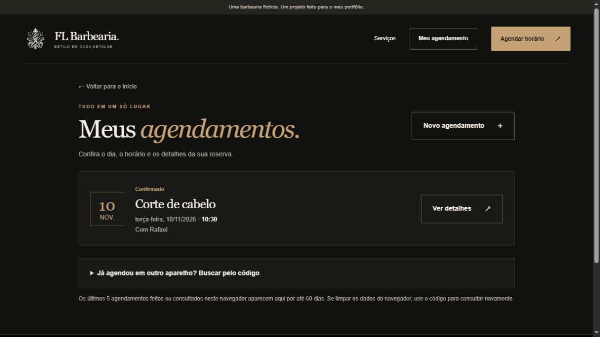

# FL Barbearia

Este é um projeto meu para o meu **portfólio de apresentação**. Criei o site de uma barbearia fictícia para praticar **HTML, CSS, JavaScript, Java e SQL**, com visual preto, creme e cobre.

**[Abrir a FL Barbearia](https://fl-barbearia.onrender.com/)**

No plano gratuito, a primeira abertura após um período sem visitas pode demorar cerca de um minuto.

## O que dá para fazer

- Agendar em duas etapas: primeiro o serviço e o dia; depois o horário e seus dados.
- Ver dia, horário e profissional em “Meu agendamento”, sem redigitar o código no mesmo navegador.
- Consultar em outro aparelho usando o código e o telefone da reserva.
- Cancelar pelos detalhes do agendamento, confirmando o telefone.

O navegador lembra os códigos das últimas cinco reservas por até 60 dias. Nome e telefone não ficam nesse lembrete. Se limpar os dados do navegador, ainda dá para consultar com o código e o telefone.

A agenda respeita a duração dos serviços, o almoço, o fechamento e os horários já reservados. O banco impede duas reservas no mesmo intervalo com o mesmo profissional, mesmo quando os pedidos chegam juntos.

Serviços, preços e profissionais são fictícios. Use dados de exemplo para conhecer o projeto. Não há pagamentos ou envio de mensagens.

## Como funciona

Usei formulários comuns: o Java recebe os dados e devolve a página pronta. O JavaScript cuida de pequenas interações, como o menu e a cópia do código da reserva. Não usei Bootstrap, frameworks ou APIs externas para os agendamentos.

Online, a aplicação usa **PostgreSQL no Neon** e hospedagem no **Render**, com a senha guardada na configuração privada do servidor. No computador, ela também funciona com **H2**, que salva o banco em um arquivo local.

O código das páginas fica em `site`. Em `src/barbearia`, separei as regras em `Agenda`, o banco em `Banco`, as páginas em `Pagina` e o atendimento dos formulários em `Servidor`. `Configuracao` ajusta a conexão e o endereço conforme o ambiente.

## Como abrir no computador

Na versão completa para **Windows 64 bits**, extraia o ZIP inteiro e abra **ABRIR_FL_BARBEARIA.bat**. O Java já está incluído nessa versão. Não abra o inicializador de dentro do ZIP.

O site abre em **http://127.0.0.1:8085/**. Mantenha a janela do programa aberta enquanto usa. Os dados locais ficam em `dados` e não são enviados para o banco online.

Para desenvolver a partir deste repositório, use um JDK 21. No Windows, `compilar.bat` gera o programa. Em Linux, use `sh compilar.sh`. Depois, execute `java -jar fl-barbearia.jar` na pasta do projeto. Quem usa a versão pronta não precisa compilar.

## Testes e publicação

Os testes em `testes` conferem as regras da agenda, a configuração, o PostgreSQL e o envio dos formulários. O GitHub executa essas verificações e testa o pacote de hospedagem automaticamente.

Para publicar no Render, o arquivo `render.yaml` seleciona o plano **Free**. A conexão fornecida pelo Neon deve ser cadastrada como `DATABASE_URL` no painel privado do Render. O endereço público e a porta são identificados pela hospedagem. O site usa o fuso de São Paulo.

As credenciais e os bancos locais ficam fora do GitHub. Os planos gratuitos têm limites de uso; no Render, o primeiro acesso após um período sem visitas pode demorar para iniciar.

## Créditos

O símbolo foi fornecido por mim para o projeto. A fotografia vem do [Unsplash](https://images.unsplash.com/photo-1621645582931-d1d3e6564943), sob a [licença do Unsplash](https://unsplash.com/license). As bibliotecas [H2](https://h2database.com) e [PostgreSQL JDBC](https://jdbc.postgresql.org) são distribuídas sem modificações, com suas licenças em `lib`. A versão completa para Windows inclui o [Eclipse Temurin](https://adoptium.net), com as licenças originais em `java`.

**Felipe Landgraf** · Estudante de Desenvolvimento de Sistemas no **COTIL–Unicamp**.
